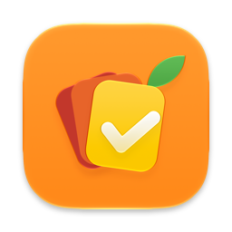
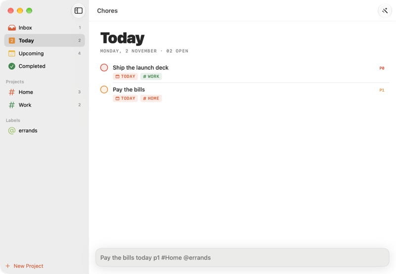

<p align="center"></p>

<h1 align="center">Chores</h1>

<p align="center">A sleek to-do list with projects, priorities and due dates you type in plain words.</p>

<p align="center"><a href="https://lamp.dev/?repo=https://github.com/lampdotdev/chores&amp;from=readme"></a></p>

<p align="center"><a href="#build-it-yourself">Build it yourself</a></p>

<p align="center"></p>

## Make Chores yours

Each opens Lamp with a copy of Chores and that change, ready to send:

- [Make it a retro green terminal](https://lamp.dev/?repo=https://github.com/lampdotdev/chores&from=readme&ask=Make%20it%20a%20retro%20green%20terminal)
- [Let tasks repeat on a schedule](https://lamp.dev/?repo=https://github.com/lampdotdev/chores&from=readme&ask=Let%20tasks%20repeat%20on%20a%20schedule)
- [Turn it into a packing list](https://lamp.dev/?repo=https://github.com/lampdotdev/chores&from=readme&ask=Turn%20it%20into%20a%20packing%20list)

## Open it in Lamp

[Lamp](https://lamp.dev) is a Mac app that builds apps from a description and changes them as you ask. [Open Chores in Lamp](https://lamp.dev/?repo=https://github.com/lampdotdev/chores&from=readme) for a copy of your own, to use and to change as you like, with the credits below kept. Or, in Lamp, choose File → Open from GitHub… and paste `https://github.com/lampdotdev/chores`.

## Build it yourself

With Apple's Command Line Tools installed (`xcode-select --install`):

```sh
zsh build.sh
```

The AI inside the app, and anything it does with other apps or devices, goes through Lamp, so those need Lamp open on the same Mac.

## Credits

- Based on [Chores](https://github.com/brunobergher) by Bruno Bergher

## License

MIT. See [LICENSE](LICENSE).
